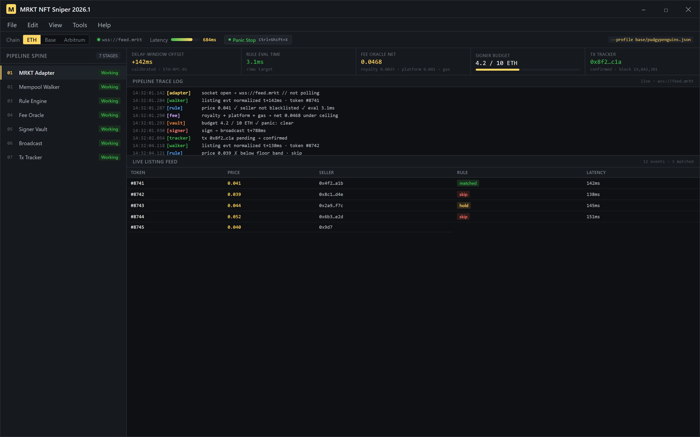
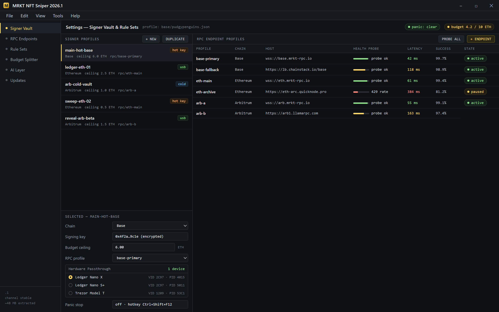
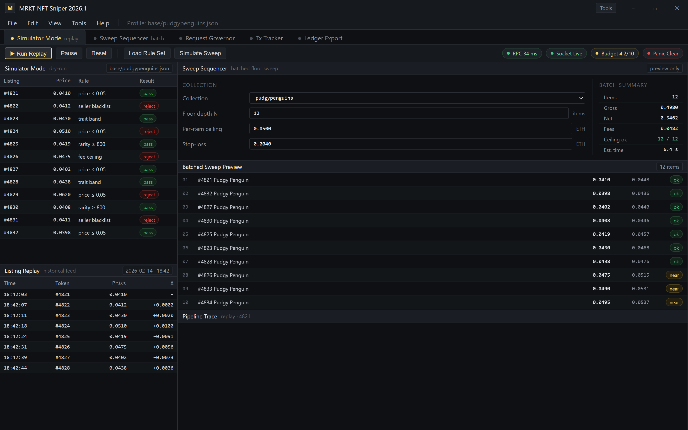

  
  
  

  

  
  
  

---

**The one sniper that actually understands MRKT's mempool, metadata races, and royalty quirks — not just another OpenSea wrapper with a gas slider.**

I built this because every "sniper" I tried in 2025 either misfired on MRKT's listing-delay window, ignored the platform's lazy-mint reveal timing, or choked the moment a collection dropped with a 3-second metadata rewrite. So in January 2026 I threw the legacy codebase out — the whole thing, every line — and rewrote it around a modular event architecture that treats MRKT listings, floor sweeps, and reveal schedules as first-class citizens instead of afterthoughts bolted onto a generic bot framework.

---

## 🧭 Table of Contents

- [Overview](#-overview)
- [What is MRKT NFT Sniper?](#-what-is-mrkt-nft-sniper)
- [The Problem](#-the-problem)
- [The Solution](#-the-solution)
- [Key Features](#-key-features)
- [Quick Start](#-quick-start)
- [Sniper Core Modules](#-sniper-core-modules)
- [Detection & Anti-Bot Modules](#-detection--anti-bot-modules)
- [Wallet & Execution Modules](#-wallet--execution-modules)
- [AI Integration](#-ai-integration)
- [How It Works](#-how-it-works)
- [All Modules Status](#-all-modules-status)
- [System Requirements](#-system-requirements)
- [Installation](#-installation)
- [Known Issues](#-known-issues)
- [FAQ](#-faq)
- [Changelog](#-changelog)

---

## 📊 Overview

Every listing walks the spine in order — filter it out or sign it.

| Category | Details |
|---|---|
| Target platform | MRKT (Ethereum + Base collections) |
| Execution model | Local desktop `.exe`, multi-wallet, hot + cold signing |
| Latency target | Sub-900ms from MRKT listing event to signed tx broadcast |
| Supported chains | Ethereum mainnet, Base, Arbitrum (MRKT-listed only) |
| Config format | JSON profiles, hot-swappable per collection |
| Update channel | Auto-updater with rollback to previous stable build |
| Footprint | ~48 MB extracted, no runtime installs required |

MRKT NFT Sniper is a desktop sniping toolkit purpose-built for the MRKT marketplace's listing feed. It watches the platform's event stream, filters listings against your rule set, and fires signed transactions through whatever RPC and signer you've configured — all from a single `.exe` you extract and run.

---

## 🖼️ What is MRKT NFT Sniper?

| Term | Explanation |
|---|---|
| MRKT | The NFT marketplace this tool targets — listings, floor sweeps, lazy mints, and reveal schedules |
| Snipe | Purchasing a listing within milliseconds of it appearing, before competing bots can front-run |
| Listing delay window | MRKT's internal ~700ms gap between listing creation and public feed visibility — the window this sniper is tuned for |
| Floor sweep | Buying the cheapest N listings of a collection in one batched sequence |
| Reveal snipe | Targeting a collection right before its metadata reveal when floor prices are still pre-reveal |
| Rule set | Your per-collection filter (price ceiling, trait filter, rarity band, seller blacklist) |
| Signer profile | A wallet configuration pairing a signing key or hardware device with a specific RPC endpoint |

Why people use it:

- **Speed where it counts** — tuned specifically for MRKT's listing-delay window, not a generic 1s polling loop.
- **Rule-driven, not reflex-driven** — you define the filter, the tool fires only when the filter matches.
- **Multi-wallet** — split risk across signer profiles, one per collection or per budget.
- **Reveal-aware** — knows when MRKT drops metadata and holds/releases the snipe accordingly.

---

## 🩸 The Problem

- Legacy snipers poll MRKT's public feed and consistently miss listings that sell inside the delay window.
- Most tools treat royalty and platform-fee math as an afterthought — you snipe "at floor" and lose money on the fee stack.
- Lazy-mint and reveal-based collections break naive snipers entirely; they buy pre-reveal garbage or overshoot on post-reveal price spikes.
- Wallet management in old tools is one key, one RPC — no isolation, no per-collection budgets, no failover.
- Anti-bot signals on MRKT (rate limits, nonce collisions, RPC bans) kill 3rd-party snipers that don't manage request pressure.
- Every "sniper" from 2024–2025 was a repackaged OpenSea bot with a different skin — nobody actually modeled MRKT's quirks.

---

## 🗡️ The Solution

| Problem | Solution |
|---|---|
| Missing listings inside the delay window | **Mempool Walker** module hooks MRKT's listing event stream directly instead of polling the public feed |
| Fee stack eats the snipe margin | **Fee Oracle** computes post-royalty, post-platform-fee net cost before the tx is signed |
| Reveal collections break naive bots | **Reveal Scheduler** holds snipes until the MRKT metadata flag flips, then fires |
| Single-key risk | **Signer Vault** isolates keys per profile with optional hardware-wallet passthrough |
| Rate limits and nonce collisions | **Request Governor** paces RPC calls and pre-allocates nonces to avoid collisions |
| Generic bot framing | **MRKT Adapter** is a first-class module tuned to the platform's actual event schema |

---

## ⚔️ Key Features

| Feature | Description | Benefit |
|---|---|---|
| Mempool Walker | Tails MRKT's listing event stream at the socket layer | Catches listings before they hit the public feed |
| Rule Engine | Per-collection JSON rules with trait, price, seller, and rarity filters | Fires only on listings you'd actually buy |
| Fee Oracle | Real-time royalty + platform-fee + gas estimate per snipe | No more "sniped at floor, lost 8%" surprises |
| Reveal Scheduler | Holds and releases snipes around MRKT metadata writes | Snipes the pre-reveal floor, not the post-reveal panic |
| Signer Vault | Multi-key with hardware passthrough and per-profile budgets | Isolation of risk across collections |
| Request Governor | RPC pacing, nonce pre-allocation, endpoint failover | Survives rate limits and endpoint bans |
| Sweep Sequencer | Batched floor sweeps with per-item cap and stop-loss | Clean sweeps without overpaying on the tail |
| Trait Filter | Filters listings by on-chain metadata traits | Skip the floor listings you don't want |
| Listing Replay | Replays historical MRKT listings against your rules offline | Tune rules before you go live |
| Panic Stop | One-key kill switch that halts all signers and cancels pending txs | Get out before a misconfig burns you |

Keys isolated per profile, rules hot-swappable per collection.

---

## 🚀 Quick Start

1. **Head to the project page** — the landing page hosts the current `.exe` build.
2. **Download the `.exe`** — single file, no installer, no runtime dependencies.
3. **Extract** to a folder you control (avoid `Program Files` — Windows will fight you on write access).
4. **Run the `.exe`** — first launch walks you through a signer profile and an RPC endpoint.
5. **Load a rule set** — start with the bundled sample rule for a collection you actually follow, then tune.

---

## 📥 Download

  

---

## 🕸️ Sniper Core Modules

### **Listing Detection**

| Feature | Effect |
|---|---|
| Mempool Walker | Sub-second listing detection via MRKT event socket |
| Feed Cross-Check | Validates listings against the public feed to catch false positives |
| Delay-Window Tuner | Auto-calibrates the detection offset per RPC endpoint |

### **Matching & Filtering**

| Feature | Effect |
|---|---|
| Rule Engine | Per-collection JSON rules evaluated in <5ms |
| Trait Filter | Rejects listings whose traits miss your target band |
| Seller Blacklist | Skips listings from known wash-trader wallets |

### **Execution**

| Feature | Effect |
|---|---|
| Sweep Sequencer | Batched floor sweeps with per-item ceiling |
| Fee Oracle | Pre-sign net-cost calculation |
| Panic Stop | Halts all signers on hotkey |

---

## 🛰️ Detection & Anti-Bot Modules

### **Rate & Nonce Management**

| Feature | Effect |
|---|---|
| Request Governor | Paces RPC calls to stay below per-endpoint limits |
| Nonce Allocator | Pre-allocates nonces across pending txs to avoid collisions |
| Endpoint Rotator | Fails over between configured RPCs on 429/5xx |

### **Signal Hygiene**

| Feature | Effect |
|---|---|
| Header Normalizer | Keeps outbound request headers consistent per endpoint |
| Retry Backoff | Exponential backoff on failed broadcasts |
| Dedup Layer | Prevents double-firing on re-broadcast listings |

### **Safety**

| Feature | Effect |
|---|---|
| Simulator Mode | Dry-runs snipes against historical events |
| Budget Guard | Hard per-profile spend ceiling |
| Kill Switch | Local + remote (file-based) stop signal |

---

## 🔐 Wallet & Execution Modules

### **Signer Management**

| Feature | Effect |
|---|---|
| Signer Vault | Per-profile key isolation |
| Hardware Passthrough | USB hardware-wallet signing path |
| Budget Splitter | Allocates spend ceiling per collection |

### **RPC**

| Feature | Effect |
|---|---|
| Endpoint Profiles | Named RPC configs swappable per collection |
| Health Probe | Periodic latency + success-rate probe per endpoint |
| Failover Chain | Ordered fallback list on endpoint failure |

### **Reconciliation**

| Feature | Effect |
|---|---|
| Tx Tracker | Watches every signed tx through confirmation |
| Fill Report | Post-snipe report with net cost, fee breakdown, and timing |
| Ledger Export | CSV export of all snipes for tax/accounting |

Tune the rules offline before the socket goes live.

---

## 🤖 AI Integration

The 2026 rebuild leans on a local inference layer for the parts of sniping that are genuinely hard to hand-tune — not to replace your rule set, but to sharpen it.

- **Rule Suggestion Engine** — reads your historical fills (if you let it) and proposes rule tweaks: price ceilings that match your actual behavior, trait bands you keep coming back to, seller patterns you've been avoiding.
- **Reveal Predictor** — a small time-series model trained on MRKT reveal cadence for collections you follow. It estimates when a metadata write is likely to land so the Reveal Scheduler can pre-arm.
- **Fee Stack Forecaster** — predicts gas at the moment your rule is likely to match, so the Fee Oracle isn't estimating from a stale gas reading.
- **Anomaly Flag** — flags snipes that look off (floor drop pattern, unusual seller activity) before they fire, so you can review.
- **Rule Explainer** — plain-English readback of any rule set, useful when you've stacked 12 conditions and forgotten what the last one does.

All AI features are local-only by default. No telemetry leaves the machine unless you explicitly enable the optional shared-models channel.

---

## 🧠 How It Works

Under the hood, MRKT NFT Sniper is an event pipeline, not a polling loop. The MRKT Adapter opens a persistent socket to the platform's listing event stream and hands raw events to the Mempool Walker, which normalizes them into a common listing shape. That shape flows into the Rule Engine, which evaluates your per-collection JSON rules against price, trait, seller, and rarity band — this is the only place your rule logic lives, and it's deliberately the fastest stage in the pipeline. Listings that pass the Rule Engine get stamped with a fee estimate from the Fee Oracle, which pulls royalty data from the collection contract, platform-fee data from MRKT's fee schedule, and a gas estimate from the Request Governor's current endpoint health snapshot. Pre-sign, the Signer Vault checks the profile's budget ceiling and the Panic Stop flag before it touches a key. Signing happens in an isolated process; the signed tx goes back to the execution layer, which broadcasts through the Request Governor's managed endpoints and hands the tx hash to the Tx Tracker. The Tx Tracker reconciles confirmations asynchronously and writes the fill report. Everything — detection, matching, signing, broadcast, reconciliation — is a separate module with its own config, its own failure mode, and its own log stream. That's the whole point of the 2026 rewrite: nothing is entangled, so when one piece breaks (and one always does), you swap the module, not the build.

---

## 📋 All Modules Status

| Module | Status | Description |
|---|---|---|
| MRKT Adapter | ✅ Working | Listing event stream connector |
| Mempool Walker | ✅ Working | Sub-second listing detection |
| Feed Cross-Check | ✅ Working | False-positive filter against public feed |
| Delay-Window Tuner | ✅ Working | Per-endpoint detection offset calibration |
| Rule Engine | ✅ Working | JSON rule evaluation |
| Trait Filter | ✅ Working | Trait-band rejection |
| Seller Blacklist | ✅ Working | Wash-trader wallet skip list |
| Sweep Sequencer | ✅